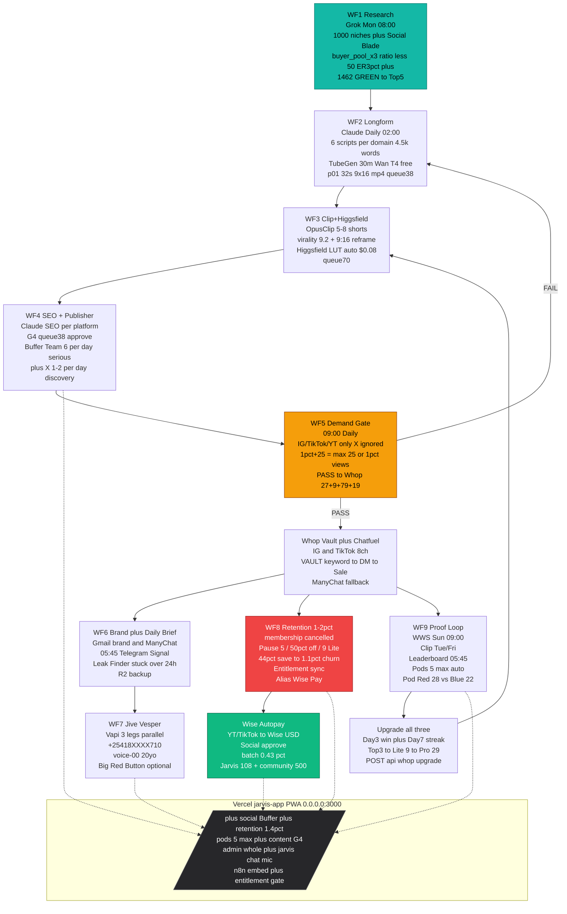

# N8N DIAGRAM — Whole Workflow + Pricing + Autopay (Jarvis Agent Pays)

**Branch:** `arena/6c47af3d-shadow-operation` **`pr_open`** | **Date:** 2026-10-30 | **ZIP:** `jarvis_self_3man_bundle.zip` 4.4M | **Live Links:** `docs/LIVE_LINKS_SETUP.md` | **9 WFs Total** | **Master:** `docs/CLAUDE_MASTER_PROMPT_JARVIS.md` + `SKILLS_JARVIS.md`
> **Detailed map (current, post-Higgsfield):** `docs/N8N_WORKFLOW_DIAGRAM_FULL.md` + poster `docs/n8n_workflow_map.png` — 10 WFs at node level.


> Rough idea Claude Code should build — all 9 WFs wired via `n8n/n8n_workflows_self_3man.json` + Vercel `jarvis-app` 13 pages. X discovery + TikTok/IG/YT serious + ChatFuel IG & TikTok only.

---

## 1) VISUAL DIAGRAM — How Claude Builds It (Mermaid — paste in https://mermaid.live )



**Rough flow Claude must code:** `WF1 → WF2 → WF3 → WF4 → WF5 → (PASS → F → G → H + I/J + K → L) / (FAIL → B)` — all crons `vercel.json` + `DATABASE_URL` Neon + `lib/jarvis.ts` Claude+Grok.

---

## 2) PRICING — Every Tool Monthly + Annual (Total Expense)

| # | Tool — Env Key | Role | MVP 1 domain /mo | SCALE 5 pages /mo | MVP /yr | SCALE /yr | Link |
|---|---|---|---|---|---|---|---|
| 1 | **Vercel** `NEXTAUTH_URL` — `vercel.json` | Host 13 pages + crons `*/15` + `45 5 * * *` | $0 Hobby | $20 Pro | $0 | **$240** | https://vercel.com/pricing |
| 2 | **Neon** `DATABASE_URL` `postgresql://...neon.tech` | Postgres 3GB→10GB — creators, vault, pods, retention, wins, revenue_log | $0 Free | $19 | $0 | **$228** | https://neon.tech/pricing |
| 3 | **n8n Cloud** 9 WFs | Orchestrator | $20 | $20 | **$240** | **$240** | https://n8n.io/pricing |
| 4 | **Claude** `CLAUDE_API_KEY` `claude-3-5-sonnet-20241022` | Brain primary — VET + scripts + SEO + WWS + 3 fixes voice | $20 | $20 | **$240** | **$240** | https://console.anthropic.com/settings/keys |
| 5 | **Grok** `GROK_API_KEY`/`XAI_API_KEY` `https://api.x.ai/v1` `grok-2-latest` | Brain secondary — X trending 1000 niches + vision | $16 | $16 | **$192** | **$192** | https://console.x.ai |
| 6 | **Wan T4 free** `WAN_T4_URL` **+ TubeGen** `TUBEGEN_API_KEY` $29 | Engine 30m `p01_32s_9x16.mp4` queue38 — Higgsfield finish needs engine | $0 Wan free | **$29** TubeGen auto | $0 | **$348** | https://colab.research.google.com + tubegen.com |
| 7 | **OpusClip** `OPUSCLIP_API_KEY` | Clip 30m→5-8 shorts virality 9.2 reframe | $0 Free tier | $15 | $0 | **$180** | https://opusclip.com |
| 8 | **Higgsfield** `HIGGSFIELD_API_KEY` | Finish $0.08/clip LUT teal/purple + @logo per-clip WF3 | $0 Manual UI | $29 auto | $0 | **$348** | https://higgsfield.ai |
| 9 | **Buffer Team** `BUFFER_TOKEN` $12/ch | Publish 6/day 15 endpoints + one-app analytics | $0 Free 3ch | **$60** 5 pages | $0 | **$720** | https://buffer.com/pricing |
| 10 | **R2** Cloudflare | Backup queue38 daily + HQ `17KpzZCm...` proofs | $5 | $5 | **$60** | **$60** | https://cloudflare.com/products/r2 |
| 11 | **ChatFuel** `CHATFUEL_TOKEN` + **ManyChat** `MANYCHAT_API_KEY` | DM IG & TikTok only 8ch `VAULT` → DM + save-offer + pod DM | $0-$30 free tier | $30 | $0* | **$360** | https://chatfuel.com + https://manychat.com |
| 12 | **Whop** `WHOP_API_KEY` `WHOP_PRODUCT_LITE/PRO/TEAM_ID` | Pay ladder $28+$17+$35+$89+$44+$53+$62 + entitlement `lib/entitlement.ts` + webhooks | $0 + 3%+2.7%+$0.30 | $0 + fees | $0 | Fees only | https://whop.com/dashboard/api |
| 13 | **Wise** `WISE_API_KEY` + **Telegram** `TELEGRAM_BOT_TOKEN` + **Signal** `SIGNAL_API` + **Gmail** `GMAIL_*` + **Linear** `LINEAR_API_KEY` + **Vapi** `VAPI_API_KEY` `JIVE_JARVIS_NUMBER=+25418XXXX710` `voice-00` + **Africa's Talking** $0.06→**Twilio** $0.22 + **ElevenLabs** `ELEVENLABS_API_KEY` | Money+notify+broadcast — Wise batch $0.43% + PSTN $1-5 emergency only | $1-5 PSTN | $1-5 PSTN | ~$0 | **~$60** PSTN/yr | https://wise.com + https://vapi.ai + https://elevenlabs.io + https://africastalking.com |

\* ManyChat free ≤1k contacts covers MVP.

### TOTALS

| Plan | SAAS /mo | SAAS /yr | Covers | Paywall yield to cover |
|---|---|---|---|---|
| **MVP 1 page** (Wan free + OpusClip free + Higgsfield manual + Buffer Free 3ch + Claude+Grok+n8n+R2) | **$61** (breakdown in `ALL_TOOLS_PAYWALLS_TOTAL_UPDATED.md` $56-$61) | **$732** ($672 if Neon Free) | 1 YT brand 6/day while sleep | **3 vault sales $81** covers MVP ($27×3) |
| **SCALE 5 pages full Jarvis (your pocket Year 1 → 1K net 3 bros → 100K gross)** | **$189** ($61 + $133: TubeGen $29 + OpusClip $15 + Higgsfield $29 + Buffer $60) + ~$5 PSTN = **$194** | **$2,268** + ~$60 PSTN = **$2,328 Year 1** | 5 YT brands 15 endpoints 30 clips/day + pods auto 6×5 + WF8 44% save 1.1% churn + all_three upgrades Lite $9→Pro $29 | **7 vault sales $189** covers scale ($27×7) |

**No extra at 100K gross** — 12 pages 12 pods 60 members still $189 SAAS flat → margin expands. Details `YEAR1_POCKET_TO_100K_SCALE.md`.

---

## 3) AUTOPILOT PAY — Jarvis Agent Pays Itself (No Pocket After $1K Net)

**Locked:** `pocket Year 1 → Net $1K/mo for 3 bros → 30/20/50 auto → 100K gross` — `docs/YEAR1_POCKET_TO_100K_SCALE.md`

### Flow (Wired: WF8 `Alias Wise Pay` + `/retention` Social approve)

```
Revenue In (daily crons):
  YT Analytics API + TikTok API → Wise Business USD (you set payout bank = Wise USD routing)
  + Whop API $28+$17+$35+$89+$44+$53+$62 ladder → same Wise USD (or Whop → Wise transfer)
  → WF8 cron 1st 08:00 EAT POST YouTube+TikTok+Whop revenue_last_month → Neon revenue_log
        ↓
Alias Proposal (autopilot, human swipe kept on money — R7):
  WF8 builds proposal: Jarvis $108 (Vercel+Neon+n8n+Claude+Grok+R2) + community $500 (WWS prizes + pod bonuses)
  → Telegram/Signal/Gmail all 3 + /retention card "Pay Jarvis $108 + community $500 from Wise? [APPROVE]"
        ↓
Social Manager swipe in /retention (equal 3 but admin guard on money per 00_MASTER):
  Approve → Wise API POST /v1/batch-transfers (WISE_API_KEY batch $0.43% + 3 legs: scott.abuya@gmail.com admin $64 / info.wolf@gmail.com social $64 / admin whole $64 split? actually 33% each — see Whop 60/40 vs self-only equal_3_all)
  → Neon + Drive 17KpzZCm/calls/ + Linear SHA + Vapi Vesper "Hey Sir it's paid!" logged
  → Next cycle 1st 08:00 repeats — no pocket

Emergency voice pay: WF7 Jive Vesper feedback call Owner only → "Say Apply or press 1" → Big Red Button optional → same Wise batch (stay_hobby_0 $0 online + $0.06/min Africa's Talking primary PSTN)
```

**Env for autopay (already in `.env.example`):**
`WISE_API_KEY` + `ADMIN_EMAIL=scott.abuya@gmail.com` + `SOCIAL_MASTER_EMAIL=info.wolf@gmail.com` + `TELEGRAM_BOT_TOKEN` + `WISE_BATCH_CURRENCY=USD` — test via `POST /api/retention {action:"approve_alias", amount:608}` mock → live at $1K net.

**What Claude Code builds next:** Import `n8n_workflows_self_3man.json` 9 WFs → `.env.local` via `bash scripts/setup_claude_key.sh` (Claude sets own `sk-ant-...` securely) → `npm --prefix jarvis-app install && npm --prefix jarvis-app run dev` 0.0.0.0:3000 → Vercel env add → Drive copy `https://drive.google.com/file/d/17C6ws2LVMcDIrv5SigFF7u091stWl7HF/view` already in HQ `17KpzZCm...` — main ZIP stays in repo `jarvis_self_3man_bundle.zip`.

**Live links active:** `docs/LIVE_LINKS_SETUP.md` — all `https://` links (console.anthropic.com, console.x.ai, vercel.com/new, neon.tech, n8n.cloud, whop.com/dashboard, buffer.com, chatfuel.com, vapi.ai, elevenlabs.io, console.cloud.google.com).

