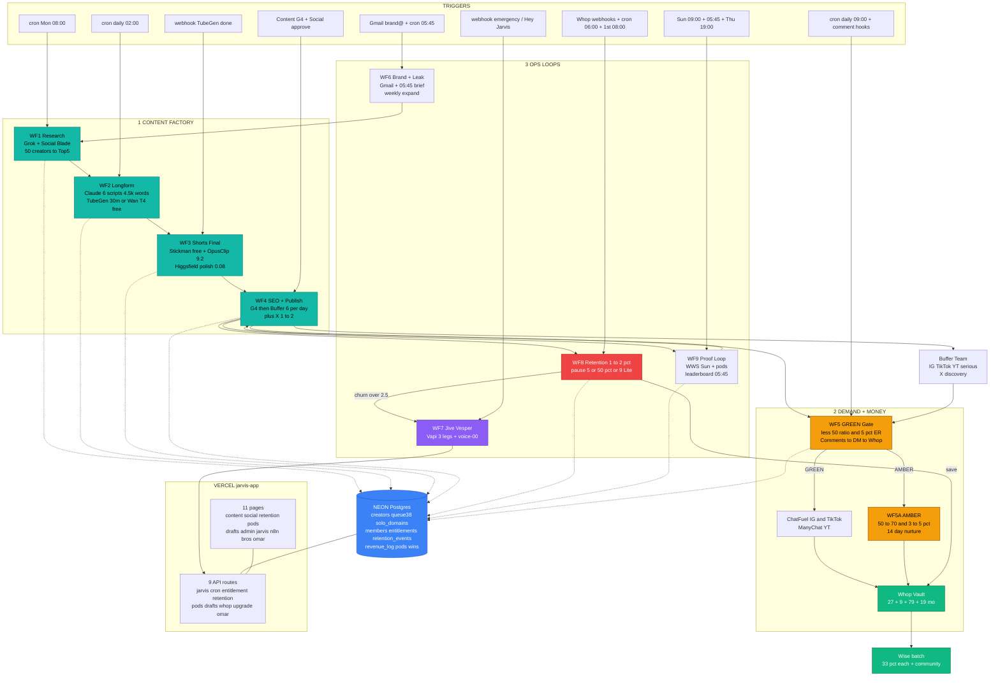
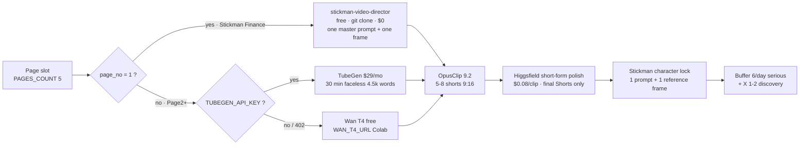

# JARVIS — FULL n8n WORKFLOW MAP (DETAILED)

**Branch:** `arena/6c47af3d-shadow-operation` · **Status:** `pr_open`
**Poster:** `docs/n8n_workflow_map.png` (3000px, 5 lanes + engine rail) · **ASCII map:** §1b · **Node tables:** §4
**Source of truth:** `n8n/n8n_workflows_self_3man.json` · **App:** `jarvis-app` (11 pages, 9 API routes)
**Workflows:** 10 entries = WF1, WF2, WF3, WF4, WF5, WF5A, WF6, WF7, WF8, WF9
**Engine:** `both_engines` — Stickman Finance free Shorts (`kaomei/stickman-video-director`) + TubeGen $29 / Wan T4 free longform → OpusClip 9.2 virality → **Higgsfield short-form final polish $0.08/clip** → Buffer 6/day + X 1–2
**Cost:** MVP **$61/mo** · SCALE 5 pages **$189/mo** (Higgsfield back for Shorts polish only — LUT/watermark stays removed)

---

## 0. How to read this map

| Symbol | Meaning |
|---|---|
| ⏰ | Cron trigger (EAT = Africa/Nairobi, UTC+3) |
| 🪝 | Webhook trigger (external service calls n8n) |
| 👤 | Human trigger (G4 approve, Big Red Button, /retention swipe) |
| 🗄 | Neon Postgres table touched |
| 🔑 | Env var required |
| ⚠ | Branch / threshold decision |
| ♻ | Fallback path if the primary fails |

Every workflow below lists: **trigger → node chain → branches → writes → emits → failure path.**
All thresholds are env-overridable (`THRESHOLD_*`) — no code change (adaptable lock 2026-10-30).

---

## 1. MASTER DIAGRAM — 10 workflows + app + money



**One-line flow:** `WF1 → WF2 → WF3 → WF4 → platforms → WF5 (GREEN→Whop / AMBER→14d→Whop) → WF8 (save or churn→WF7) → WF9 (proof WWS) → WF6 (leak→expand) → back to WF1`.

### 1b. ASCII map (copy/paste anywhere — Slack, Linear, WhatsApp)

```
                        ┌─────────────────────────── JARVIS SELF 3-MAN ───────────────────────────┐
                        │            10 n8n workflows · Vercel app · Neon · $61/$189             │
                        └────────────────────────────────────────────────────────────────────────┘

 LANE 1 · CONTENT FACTORY                              02:00 → 05:45 (you sleep)

  ┌──────────┐   ┌──────────┐   ┌──────────┐   ┌──────────┐   ┌──────────┐
  │   WF1    │──▶│   WF2    │──▶│   WF3    │──▶│   WF4    │──▶│   OUT    │
  │ Research │   │ Longform │   │  Shorts  │   │ SEO +    │   │Platforms │
  └──────────┘   └──────────┘   └──────────┘   └──────────┘   └──────────┘
   Mon 08:00      daily 02:00    TubeGen done   G4 swipe       IG/TikTok/YT
   Grok+SocialB   Claude 4.5k    OpusClip 9.2   Claude SEO     6/day serious
   top 50 GREEN   TubeGen 30m    Higgsfield.08  Buffer Team    X 1-2 discovery
   → top5         stickman free  char lock      → 30 clips     + longform upload
        │              │              │              │
        └──────────────┴──────────────┴──────▶ writes NEON queue38

 LANE 2 · DEMAND + MONEY                               09:00 gate + comment hooks

  ┌──────────┐ GREEN ┌──────────┐      ┌──────────┐      ┌──────────┐
  │   WF5    │──────▶│   DM     │─────▶│   WHOP   │      │  WF5A    │
  │  Gate    │       │ ChatFuel │      │ Vault+Wise│     │  AMBER   │
  └──────────┘       │ ManyChat │      └──────────┘      │ 14-day   │
       │ AMBER       └──────────┘            │           └──────────┘
       └────────────────────────────────────┼──────────────────┘
                                            │ $27 · $9 · $79 · $19/mo
                                            ▼
 LANE 3 · OPS LOOPS                     always on, no human

  ┌──────────┐   ┌──────────┐   ┌──────────┐   ┌──────────┐
  │   WF8    │◀─▶│   WF9    │   │   WF6    │   │   WF7    │
  │Retention │   │  Proof   │   │Brand+Leak│   │Jive+Vesper│
  │ 1-2%     │   │  WWS     │   │ 05:45    │   │  3 legs  │
  └──────────┘   └──────────┘   └──────────┘   └──────────┘
   pause $5        WWS Sun        daily brief     Vapi voice
   50% / $9 Lite   leaderboard    leak→expand     "Apply or 1"
   churn>2.5 → WF7 pods 5         → WF1 again     → execute fixes

 LANE 4 · APP · DATA · AUTOPAY            the only screens humans touch

  ┌────────────────┐   ┌────────────────┐   ┌────────────────┐
  │   jarvis-app   │◀─▶│  Neon Postgres │   │ Wise + TG + LN │
  │ 11 pages       │   │ 11 tables      │   │ 1st 08:00      │
  │ 9 API routes   │   │ single spine   │   │ $108 + $500    │
  └────────────────┘   └────────────────┘   └────────────────┘

 LANE 5 · APPROVAL + FAILOVER                    3 swipes, then auto

  G4 /content ──▶ G5 /social ──▶ G6 /retention ──▶ Wise pays
  FAIL: TubeGen→Wan · OpusClip retry x3 · Higgsfield→unpolished · Buffer→API
  SLA: 1 longform + 6 shorts + 6 posts per page per day, done 05:45 EAT
```

---

## 2. TIME MAP — what runs while you sleep (EAT)

| Time | Day | WF | What fires | Exit |
|---|---|---|---|---|
| 02:00 | daily | WF2 | Claude writes 6 scripts/domain (4,500 words) → TubeGen 30m or Wan T4 | `publisher_queue38_longform` |
| 02:15 | daily | WF2 | Telegram "6 TubeGen longforms ready" | notification |
| 02:30–04:30 | daily | WF3 | Stickman scenes + OpusClip 9.2 + **Higgsfield polish** | `publisher_queue38` `pending_G4` |
| 05:45 | daily | WF6 + WF9 | Daily brief (spend, views, replies, leak) + leaderboard top 3 | Telegram/Signal/Gmail |
| 06:00 | daily | WF8 | Churn sweep + entitlement sync | `retention_events` |
| 08:00 | Mon | WF1 / WF6 | Grok re-rank top5 + weekly page expand | `solo_domains.top5` |
| 09:00 | daily | WF5 | Demand gate on last 3 posts | GREEN/AMBER/Red |
| 09:00 | Sun | WF9 | WWS deck + replay | Whop Announcements |
| 18:00 | Tue/Fri | WF9 | Proof clip to Buffer | Buffer queue |
| 19:00 | Thu | WF9 | Teardown Zoom → Vesper transcribe → 32s teaser | Buffer next day |
| 1st 08:00 | monthly | WF8 | Wise autopay proposal → Social approve → batch | `revenue_log` |
| any | webhook | WF5/WF5A | Comment → DM within 2 min | Whop purchase |
| any | webhook | WF8 | `membership_cancelled` / `payment_failed` | save offer |
| any | webhook | WF7 | Emergency voice broadcast 3 legs | transcript + fixes |

```mermaid
gantt
    title JARVIS 24h clock (EAT)
    dateFormat HH:mm
    axisFormat %H:%M
    section Night build
    WF2 scripts and longform 02:00      :a1, 02:00, 30m
    WF3 clip polish 02:30               :a2, 02:30, 120m
    section Morning
    Daily brief 05:45                   :b1, 05:45, 15m
    Churn sweep 06:00                   :b2, 06:00, 20m
    Demand gate 09:00                   :b3, 09:00, 30m
    section Day
    Comment DM webhooks all day         :c1, 09:30, 600m
    section Evening
    Proof clips Tue Fri 18:00           :d1, 18:00, 30m
    Teardown Thu 19:00                  :d2, 19:00, 60m
```



---

## 3. DATA SPINE — Neon Postgres tables

| Table | Owner WF | Key columns | Read by |
|---|---|---|---|
| `creators` | WF1 | handle, platform, followers, avg_comments, buyer_pool_x3, ratio, er, gate | WF1, WF5 |
| `solo_domains` | WF1 → WF2 | domain, niche, rank, top5[], page_no, engine | WF2, WF6 |
| `publisher_queue38_longform` | WF2 | date, domain, video_url, words, status | WF3 |
| `publisher_queue38` | WF3/WF4 | date, domain, caption, hashtags, video_url, virality, status | WF4, WF9 |
| `members` | WF5 | whop_user_id, plan, tier, joined_at, last_active | WF8, WF9, app |
| `entitlements` | WF8 | whop_user_id, tier, active, synced_at | `lib/entitlement.ts` |
| `retention_events` | WF8 | user_id, offer, accepted, saved, cancel_click_at | WF8, app |
| `pods` | WF9 | pod_id, user_id, streak, points | WF9 |
| `wins` | WF9 | user_id, proof_url, verified, clip_queued | WF9 |
| `revenue_log` | WF8 | month, yt, tiktok, whop, wise_transfer_id | WF8, Wise |
| `operator_context` | WF6 | leak_finder, spend_today, signals | WF6, `/api/cron/daily-brief` |

**Rule:** every WF writes only its own table; the app reads via API routes — never cross-writes.

---

## 4. WORKFLOW-BY-WORKFLOW (node level)

### WF1 — Research Best Monetizable Weekly
**Role:** Content G4 · **Trigger:** ⏰ `0 8 * * 1` (Mon 08:00 EAT) · **id:** `wf1_research_grok`

| # | Node (n8n type) | What it does | 🔑 env / config | 🗄 |
|---|---|---|---|---|
| 1 | Postgres SELECT | Pull 50 GREEN creators ranked by `buyer_pool_x3*er`: `SELECT handle,platform,followers,avg_comments,buyer_pool_x3,ratio,er,gate FROM creators WHERE gate='GREEN' ORDER BY buyer_pool_x3*er DESC LIMIT 50` (1,462 GREEN in DB) | `DATABASE_URL` | `creators` |
| 2 | HTTP Request ×4 | Social Blade + HypeAuditor + NotJustAnalytics/Picuki + Grok X trending → live `buyer_pool_x3`, `ratio`, `ER` | `GROK_API_KEY` `XAI_BASE_URL` | — |
| 3 | IF (8-Gate) | `ER > THRESHOLD_ER_GREEN` **and** `ratio < THRESHOLD_RATIO_GREEN` **and** `buyer_pool_x3 > THRESHOLD_BUYER_POOL_MIN` → GREEN else AMBER | `THRESHOLD_ER_GREEN=5` `THRESHOLD_RATIO_GREEN=50` `THRESHOLD_BUYER_POOL_MIN=3000` | — |
| 4 | Claude Code | "Rank top 5 most monetizable for self content vault $27" → JSON | `CLAUDE_API_KEY` | — |
| 5 | Telegram + Gmail | "Sir top5 monetizable domains: 1) Psych Hack 8.2K pool 5.1% ER …" | `TELEGRAM_BOT_TOKEN` `GMAIL_OAUTH` | — |
| 6 | Postgres UPDATE | `solo_domains.top5 = [...]`, `page_no` per `PAGES_COUNT` | `PAGES_COUNT=5` | `solo_domains` |

**Branches:** GREEN → top5; AMBER → stays in pool, re-checked next Monday.
**Failure ♻:** Social Blade 429 → Grok-only re-rank; Grok down → previous week's top5 kept, Telegram warns.
**Emits:** `solo_domains.top5` consumed by WF2 at 02:00.

---

### WF2 — Longform Make (sleep hours)
**Role:** Content G4 · **Trigger:** ⏰ `0 2 * * *` · **id:** `wf2_longform_tubegen`

| # | Node (n8n type) | What it does | 🔑 env / config | 🗄 |
|---|---|---|---|---|
| 1 | Postgres SELECT | `SELECT top5 FROM solo_domains` — scalable `PAGES_COUNT` pages: Page1 Stickman Finance (free Shorts), Page2+ other niches (TubeGen longform) | `PAGES_COUNT=5` | `solo_domains` |
| 2 | Claude Code | 6 scripts/domain → `3 × 8s short + 2 × 32s long + 1 × 60s deep` = **4,500 words ≈ 30 min**, Butler tone, JSON `{title,script,captions,hashtags}` | `CLAUDE_API_KEY` | — |
| 3 | HTTP Request → TubeGen | 30-min faceless longform per domain; **♻ fallback** `WAN_T4_URL` (Colab free) if TubeGen missing/fails | `TUBEGEN_API_KEY` `WAN_T4_URL` | — |
| 4 | Stickman branch (Page1) | `stickman-video-director` free scenes → 9:16 master, one master prompt + one reference frame = character lock | `STICKMAN_REPO_URL` `STICKMAN_FREE_REPO` | — |
| 5 | Drive Upload | `NUMINOUS_WHOP_DEPLOY/17KpzZCm/` ← `p01_32s_9x16.mp4` (+ Katana grade if needed) | `DRIVE_OAUTH` | — |
| 6 | Postgres INSERT | `publisher_queue38_longform (date, domain, video_url, status='clip_pending')` | — | `publisher_queue38_longform` |
| 7 | Telegram | "Sir 6 TubeGen longforms ready 02:15 EAT — Linear SHA" | `TELEGRAM_BOT_TOKEN` `LINEAR_API_KEY` | — |

**Output:** **1 longform × `PAGES_COUNT` pages/day** → `pending clip`. (MVP 1 page = 1/day; 5 pages = 5/day.)
**Failure ♻:** TubeGen 402/timeout → Wan T4; Wan down → queued retry 03:00, Telegram "engine down".
**Note:** OpusClip cannot create the source — engine is mandatory.

---

### WF3 — Stickman Finance Shorts + OpusClip virality + Higgsfield polish
**Role:** Content G4 · **Trigger:** 🪝 webhook "TubeGen finished" · **id:** `wf3_autoclip_virality`

| # | Node (n8n type) | What it does | 🔑 env / config | 🗄 |
|---|---|---|---|---|
| 1 | Webhook | `POST /webhook/tubegen-done` per domain `{domain, file_url, words}` | — | — |
| 2 | IF engine = stickman | Page1 → `stickman-video-director` free render; Page2+ → TubeGen mp4 | `ENGINE_PROVIDER=both_engines` | — |
| 3 | ffmpeg | Katana `p01_32s_9x16.mp4` → 9:16 master, loudness −14 LUFS, caption burn | — | — |
| 4 | HTTP OpusClip | 30m → **5–8 shorts**, virality target **9.2**, auto-reframe 9:16, captions | `OPUSCLIP_API_KEY` | — |
| 5 | HTTP Higgsfield | **short-form final polish $0.08/clip** — upscale / clean / smooth the **final Shorts only** (no teal-purple LUT, no watermark) | `HIGGSFIELD_API_KEY` | — |
| 6 | Character lock | Stickman Finance: 1 master prompt + 1 reference frame → identity consistent across clips (replaces old LUT branding) | `config/adaptable.json → content.engine_hybrid.brand_lock` | — |
| 7 | Postgres INSERT | `publisher_queue38 (date, domain, caption, video_url, virality, status='pending_G4')`, schedule 38/day | — | `publisher_queue38` |
| 8 | Linear + Telegram | Create issue SHA "6 clips ready — content guy G4" | `LINEAR_API_KEY` `TELEGRAM_BOT_TOKEN` | — |

**flow_tier:** `Hybrid both_engines: stickman free Shorts + TubeGen longform → OpusClip 9.2 → Higgsfield $0.08 short-form polish → character lock → Buffer`.
**Failure ♻:** OpusClip 429 → retry 3× backoff then Wan-clip fallback; Higgsfield credit out → publish unpolished + Telegram alert (never blocks the queue).

---

### WF4 — SEO (Claude) + Publisher (Buffer)
**Role:** Content G4 + Social manager · **Trigger:** 👤 `queue38 pending_G4` → G4 approve · **id:** `wf4_seo_publisher_buffer`

| # | Node (n8n type) | What it does | 🔑 env / config | 🗄 |
|---|---|---|---|---|
| 1 | Vercel `/content` | Content guy sees `pending_G4` cards → **one initial G4 approve** (not in improve loop) | app `/content` | `publisher_queue38` |
| 2 | Claude Code | SEO pack per platform: IG hashtags ≠ TikTok hooks ≠ YT titles, `buyer_pool_x3` targeting | `CLAUDE_API_KEY` | — |
| 3 | Postgres UPDATE | `status='content_approved'` | — | `publisher_queue38` |
| 4 | Vercel `/social` | Social manager single frontend: analytics + Buffer queue preview → Approve | app `/social` | — |
| 5 | Postgres UPDATE | `status='social_approved'` | — | `publisher_queue38` |
| 6 | HTTP Buffer | Schedule `BUFFER_SERIOUS_DAILY=6`/day serious (IG/TikTok/YT) + `BUFFER_X_DAILY=2`/day X discovery (unlimited) | `BUFFER_TOKEN` `PLATFORMS` `X_MODE` | — |
| 7 | Telegram | "Sir 6/day live via Buffer — Linear Done SHA" | `TELEGRAM_BOT_TOKEN` | — |

**Rule:** X = discovery filler only (1–2/day), **not** counted in the 6/day serious. Longform 30m posts as its own YT upload.
**Failure ♻:** Buffer 401 → Publisher fallback via platform APIs; per-platform retry 3×; failures surface in `/social` as red cards.

---

### WF5 — GREEN Demand FAST-CLOSE
**Role:** Social manager · **Trigger:** ⏰ `0 9 * * *` + 🪝 comment webhooks IG/TikTok/YT (X ignored) · **id:** `wf5_demand_whop_chatfuel`

| # | Node (n8n type) | What it does | 🔑 env / config | 🗄 |
|---|---|---|---|---|
| 1 | HTTP analytics | IG + TikTok + YT only: views + replies on last 3 posts; Social Blade alternatives daily ER check | `IG_TOKEN` `TIKTOK_TOKEN` `YT_TOKEN` | — |
| 2 | IF GREEN | `ratio < THRESHOLD_RATIO_GREEN` **and** `er >= THRESHOLD_ER_GREEN` **and** gate GREEN → GREEN; else AMBER check | `THRESHOLD_RATIO_GREEN=50` `THRESHOLD_ER_GREEN=5` | `creators` |
| 3 | ChatFuel / ManyChat | Auto-DM `VAULT` keyword within **2 min** — ChatFuel IG & TikTok, ManyChat YT (ChatFuel cannot do YT) | `CHATFUEL_TOKEN` `MANYCHAT_API_KEY` | — |
| 4 | Hard close | 3-email cap → **FINAL TERMS** one-pager 10 pts, sign only after PASS (no free audit, Rule 9) | `ADMIN_EMAIL` | — |
| 5 | Whop API | Vault ladder `$27 + $9 + $79 + $19/mo`, grant to `scott.abuya@gmail.com` + `info.wolf@gmail.com`, Buffer Team | `WHOP_API_KEY` `WHOP_PRODUCT_LITE_ID` `WHOP_PRODUCT_PRO_ID` | `members` |
| 6 | ChatFuel Push / ManyChat Push | 8 channels push → Jarvis DM auto, social manager reviews in one app | `CHATFUEL_TOKEN` `MANYCHAT_API_KEY` | — |
| 7 | Gmail + Telegram | "Sir PASS — GREEN fast-close, vault live" to all 3 pods | `GMAIL_OAUTH` `TELEGRAM_BOT_TOKEN` | — |

**Rules:** Comments→DM→Whop **same day**, no 14-day wait; no Whop before PASS; strict 1%+25 on IG/TikTok/YT only.
**Failure ♻:** ChatFuel quota → ManyChat fallback; Whop 5xx → retry + hold grant, Telegram "manual grant needed".

---

### WF5A — AMBER 14-Day Nurture
**Role:** Social manager · **Trigger:** ⚠ AMBER branch from WF5 09:00 · **id:** `wf5a_amber_14day`

| # | Node | What it does | Config |
|---|---|---|---|
| 1 | IF AMBER | `ratio 50–70` **and** `er 3–5%` → enroll; else RED → HOLD + improve loop | `THRESHOLD_RATIO_AMBER_MAX=70` `THRESHOLD_ER_AMBER_MIN=3` `THRESHOLD_ER_AMBER_MAX=5` |
| 2 | ChatFuel + ManyChat enroll | Day 1–3 Value Proof (1 script moving + WF3 value clip) | `CHATFUEL_SCOPE=IG&TikTok` |
| 3 | Sequence | Day 4–7 DM scripts + teardown (quietwolfzz 514K case + GS variants) | — |
| 4 | Sequence | Day 8–14 DM close + Whop `$19/mo` Circle — daily CTA (not 3-email cap) | `TIER_CIRCLE_PRICE=19` |
| 5 | IF YES any day | Exit 14-day → jump to WF5 GREEN fast-close FINAL TERMS | — |
| 6 | Post-14d no YES | HOLD → WF6 leak finder + WF1 re-rank; improve loop: A/B Higgsfield short-form + OpusClip 9.2 + daily ER + weekly Grok re-rank + Whop ladder A/B | — |

**Rule:** AMBER and GREEN share the same Whop ladder; AMBER is never blocked from buying.

---

### WF6 — Brand Gmail + Daily Leak Finder + Weekly Expand + 05:45 Brief
**Role:** Owner · **Trigger:** 🪝 Gmail `brand@*` + ⏰ `45 5 * * *` + weekly | **id:** `wf6_brand_daily_leak`

| # | Node | What it does | 🔑 | 🗄 |
|---|---|---|---|---|
| 1 | Gmail Trigger | `brand@*` inbox → Claude classify brand deal → Telegram "brand deal inbound" | `GMAIL_OAUTH` `CLAUDE_API_KEY` `NICHES_POOL` | — |
| 2 | Webhook ManyChat/ChatFuel | New subscriber → replies → Whop entitlement → Telegram "new vault buyer $27" | `MANYCHAT_API_KEY` `CHATFUEL_TOKEN` | `members` |
| 3 | Cron 05:45 | Telegram + Gmail "Shadow Hot" + Signal ×3: 6 videos live, views, replies, 1 Whop, n8n spend, `leak_finder` biggest leak from `operator_context` | `TELEGRAM_BOT_TOKEN` `SIGNAL_API` | `operator_context` |
| 4 | Weekly Mon 08:00 | WF1 re-rank → if GREEN pool expands → auto-expand pages via `tools/big_run_1000.py` + WF9 pods | `PAGES_COUNT` | `solo_domains` |

**Rule (your lock):** `leak_expand` = **daily leak finder → weekly expand**, superfast to Whop.
**Failure ♻:** Gmail quota 429 → queue for next hour; brief fails → sell Telegram text-only from DB.

---

### WF7 — Jive One Permanent Broadcast + Vesper Feedback
**Role:** Owner (all 3 legs) · **Trigger:** 🪝 emergency from WF6 + 👤 "Hey Jarvis" / `/parallel` / Big Red Button | **id:** `wf7_jive_vesper_broadcast`

| # | Node | What it does | 🔑 |
|---|---|---|---|
| 1 | Webhook | Emergency detector → `JIVE_JARVIS_NUMBER` (env only, never committed) | `JIVE_JARVIS_NUMBER` |
| 2 | Vapi SIP | One permanent number → **parallel broadcast 3 legs** (Owner all / Content only / Social only), Voiceflow 3 KBs via n8n webhook to Neon | `VAPI_API_KEY` |
| 3 | Voice | **Vesper** 20yo playful/witty; per-role intro ("Hey Sir it's Vesper!" / "Hey love!" / "Hey star!"), ElevenLabs `voice-00` | `ELEVENLABS_API_KEY` |
| 4 | Whisper | Transcribe each leg → Neon transcript + Drive `17KpzZCm/calls/` + Linear SHA + `/admin` log | `OPENAI_WHISPER` (or local) |
| 5 | Claude | Generates 3 fixes → Voiceflow presents them in Vesper's voice | `CLAUDE_API_KEY` |
| 6 | Vapi feedback | Call **Owner only** on same Jive number: "Say Apply or press 1" → Big Red Button optional double-confirm → execute via n8n | `VAPI_API_KEY` |

**Cost:** Vapi $0 WebRTC online · PSTN $0.06–0.22/min **emergency only**.
**Failure ♻:** leg fails → retry ×2 then SMS/Signal fallback; recording missing → transcript-only.

---

### WF8 — Retention 1–2% Save Engine + Entitlement Sync + Wise Autopay
**Role:** Owner · **Trigger:** 🪝 Whop `membership_cancelled` / `payment_failed` + ⏰ `0 6 * * *` + 👤 `/retention` save + ManyChat inactive 3d · **id:** `wf8_retention_1_2`

| # | Node | What it does | 🔑 | 🗄 |
|---|---|---|---|---|
| 1 | Whop webhook | `membership_cancelled` **before** final cancel: `user_id, plan, reason, cancel_click_at` | `WHOP_WEBHOOK` | `retention_events` |
| 2 | IF guard | Skip if last save offer < 30d (max 1 save/30d) | — | `retention_events` |
| 3 | Postgres SELECT | scripts_count, streak, pod_id, last_agent_use, tier via `checkEntitlement` | — | `members`, `pods` |
| 4 | HTTP Whop | Verify membership active + `card_last4` | `WHOP_API_KEY` | — |
| 5 | Claude | Personalized save copy in Vesper tone: "Sir you have 47 scripts + Day 4 streak + pod Red needs you — Pause $5 keeps all vs cancel deletes in 7d" | `CLAUDE_API_KEY` | — |
| 6 | Telegram + ChatFuel + ManyChat | Save card: `[Pause $5]` `[50% off $9.50]` `[Downgrade $9 Lite]` — one-click via Whop API | `TIER_CIRCLE_PRICE=19` `TIER_LITE_PRICE=9` | — |
| 7 | Webhook choice | Pause/discount/downgrade → `retention_events saved`, `saved_rate++`, Telegram + Linear + optional Vesper voice note | — | `retention_events` |
| 8 | ELSE cancel | churn++ ; if `churn7d > 2.5%` → **WF7 emergency broadcast** ("Sir churn 3.1%") → trigger win clip + office hour | — | `revenue_log` |
| 9 | Entitlement sync | Whop active → Neon `entitlements.tier=pro/lite` → `lib/entitlement.ts has_access` | `DATABASE_URL` | `entitlements` |
| 10 | Alias Wise Pay | Cron `0 8 1 * *` (1st 08:00): YouTube + TikTok + Whop revenue → `revenue_log` → build proposal (Jarvis $108 + community $500) → Social approves in `/retention` → Wise `POST /v1/batch-transfers` 33% each | `WISE_API_KEY` `WISE_BATCH_CURRENCY=USD` | `revenue_log` |

**Rule:** pause = still active = **0% churn**; churn counts only if all 3 offers declined.
**Failure ♻:** Whop webhook missed → cron 06:00 sweep reconciles; Wise 4xx → hold + Telegram "money needs you".

---

### WF9 — Proof Loop (WWS + Leaderboard + Pods)
**Role:** Social manager · **Trigger:** ⏰ Sun 09:00 / `45 5 * * *` / Thu 19:00 + 🪝 win submit · **id:** `wf9_proof_loop`

| # | Node | What it does | 🔑 | 🗄 |
|---|---|---|---|---|
| 1 | Cron Sun 09:00 | WWS deck: new Whop memberships, Buffer top views, streaks, vault wins → Claude summary "12 wins $340 new, @wolf_ke $90 with Agent" | `CLAUDE_API_KEY` | `wins` |
| 2 | HTTP OpusClip | Auto fine-tune proof screenshot → Drive `proofs/` → `proof_queue` | `OPUSCLIP_API_KEY` | `wins` |
| 3 | Vercel `/social` | Buffer proof clip Tue/Fri 18:00 → ChatFuel DM inactive 3d → ManyChat 8ch WWS announcement | `BUFFER_TOKEN` | — |
| 4 | Cron 05:45 | Buffer analytics top 3 → `leaderboard` → Telegram + Whop Chat all pods "Top today @psych_mind 12k #2 you 4k Pod Red 28 vs Blue 22 — keep streak?" | `TELEGRAM_BOT_TOKEN` | `pods` |
| 5 | Webhook win | Verify via Whop API + screenshot → `wins` → queue Fri proof clip → leaderboard +1 | `WHOP_API_KEY` | `wins` |
| 6 | Pod auto-assign | On join → 5 pods via Whop Chat app → `pods(pod_id,user_id,streak)` | — | `pods` |
| 7 | Thu 19:00 | Teardown Zoom (Whop Event) → Vapi Vesper transcribe → Neon vault → 32s teaser → Buffer next day | `VAPI_API_KEY` | — |

**Targets:** WWS replay 40% · activation 85% in 7d · DAU 60% · save 45% · alert if churn > 2.5% (7d rolling).

---

### 4b. Three human gates + failover (Lane 5 of the poster)

| Gate | Screen | Who | What it blocks |
|---|---|---|---|
| **G4** | `/content` | Content guy | Buffer publish — one initial approve per clip, not in the improve loop |
| **G5** | `/social` | Social manager | Scheduling — Buffer queue preview + per-platform analytics |
| **G6** | `/retention` | Owner (admin guard) | Wise batch + save offers — only owner moves money |
| **G7** | Vapi call | Owner | "Say Apply or press 1" → execute remote fix |

**Failover matrix (automatic, no human):**

| Failure | Auto action |
|---|---|
| TubeGen 402 / quota | → `WAN_T4_URL` free Colab |
| OpusClip 429 | retry ×3 with backoff |
| Higgsfield 402 | publish unpolished + Telegram top-up alert |
| Buffer 401 | platform API direct fallback |
| Whop webhook missed | 06:00 cron reconcile |
| Wise 4xx | hold batch + Telegram "money needs you" |
| Neon timeout | retry ×3 → dead-letter + Linear |

**SLA per page per day:** 1 × 30-min longform · 6 shorts · 6 serious posts · 1–2 X discovery · DMs on every comment within 2 min. At `PAGES_COUNT=5` → **5 longforms + 30 shorts + 30 posts**, all built by 05:45 EAT.

---

## 5. ENGINE ROUTING — hybrid `both_engines`



| Decision | Env | Default | Effect |
|---|---|---|---|
| Engine mode | `ENGINE_PROVIDER` | `both_engines` | `stickman_only` / `tubegen_only` / `both_engines` |
| Pages | `PAGES_COUNT` | `5` | longforms/day = PAGES_COUNT |
| Serious/day | `BUFFER_SERIOUS_DAILY` | `6` | IG + TikTok + YT |
| X discovery/day | `BUFFER_X_DAILY` | `2` | not counted in 6 |
| Polish on/off | `HIGGSFIELD_ENABLED` | `true` | can disable per day without redeploy |

---

## 6. APPROVAL GATES — who presses what

| Gate | Where | Who | Blocks |
|---|---|---|---|
| G1 Research | Telegram brief | Owner | nothing (informational) |
| G2 Engine | auto | — | — |
| G3 Clip/polish | auto | — | — |
| **G4 Content** | `/content` | Content G4 | Buffer publish |
| **G5 Social** | `/social` | Social manager | schedule |
| G6 Money | `/retention` | Owner (admin guard) | Wise batch |
| G7 Voice execute | Vapi "Apply / 1" | Owner | any remote fix |

Only **G4 + G5 + G6** require a human swipe; everything else is automatic.

---

## 7. ERROR / RETRY MATRIX

| Failure | Detected by | Auto action | Human alert |
|---|---|---|---|
| TubeGen 402/quota | HTTP status | → `WAN_T4_URL` free | Telegram "engine fallback" |
| OpusClip 429 | HTTP status | 3× backoff retry | only after 3 fails |
| Higgsfield out of credits | HTTP 402 | publish unpolished, queue flag | Telegram "top-up $29" |
| Buffer 401 | HTTP status | platform API direct fallback | `/social` red card |
| ChatFuel quota | HTTP status | ManyChat fallback | silent |
| Whop webhook missed | cron 06:00 reconcile | re-grant from DB state | Telegram "reconciled" |
| Wise 4xx | HTTP status | hold batch | Telegram "money needs you" |
| n8n execution crash | n8n error workflow | retry ×2 → dead-letter | Telegram + Linear |
| Neon connection | node error | retry 3× | Telegram |

---

## 8. ENV / SECRETS MATRIX

| Group | Keys | Used by |
|---|---|---|
| Brain | `CLAUDE_API_KEY`, `GROK_API_KEY` / `XAI_API_KEY` | WF1, WF2, WF4, WF5A, WF7, WF8, WF9 |
| Engines | `ENGINE_PROVIDER`, `PAGES_COUNT`, `TUBEGEN_API_KEY`, `WAN_T4_URL`, `STICKMAN_REPO_URL`, `STICKMAN_FREE_REPO` | WF2, WF3 |
| Clip / polish | `OPUSCLIP_API_KEY`, `HIGGSFIELD_API_KEY`, `HIGGSFIELD_ENABLED` | WF3, WF9 |
| Publish | `BUFFER_TOKEN`, `PLATFORMS`, `X_MODE`, `BUFFER_SERIOUS_DAILY`, `BUFFER_X_DAILY` | WF4, WF9 |
| DM | `CHATFUEL_TOKEN`, `CHATFUEL_SCOPE`, `MANYCHAT_API_KEY` | WF5, WF5A, WF8, WF9 |
| Money | `WHOP_API_KEY`, `WHOP_WEBHOOK`, `WHOP_PRODUCT_LITE_ID`, `WHOP_PRODUCT_PRO_ID`, `WISE_API_KEY`, `TIER_*` | WF5, WF8 |
| Thresholds | `THRESHOLD_RATIO_GREEN=50`, `THRESHOLD_ER_GREEN=5`, `THRESHOLD_RATIO_AMBER_MAX=70`, `THRESHOLD_ER_AMBER_MIN=3`, `THRESHOLD_BUYER_POOL_MIN=3000` | WF1, WF5, WF5A |
| Niches | `NICHES_POOL` (9, Stickman Finance first) | WF1, WF2, WF6 |
| Notify | `TELEGRAM_BOT_TOKEN`, `SIGNAL_API`, `GMAIL_OAUTH`, `LINEAR_API_KEY` | all |
| Voice | `VAPI_API_KEY`, `JIVE_JARVIS_NUMBER`, `ELEVENLABS_API_KEY` | WF7 |
| Data | `DATABASE_URL` (Neon), `DRIVE_OAUTH`, `R2_*` | all |

Secrets live in **Vercel env + n8n credentials only** — never in git (`JIVE_JARVIS_NUMBER` explicitly excluded).

---

## 9. COST LANES

| Lane | MVP 1 page | SCALE 5 pages | Notes |
|---|---|---|---|
| Vercel | $0 Hobby | $20 Pro | embeds + crons |
| Neon | $0 free | $19 | 3→10 GB |
| n8n Cloud | $20 | $20 | 10 WFs |
| Claude | $20 | $20 | scripts + SEO + copy |
| Grok | $16 | $16 | research |
| TubeGen | $0 Wan free | **$29** | longform engine |
| OpusClip | $0 free | **$15** | virality |
| **Higgsfield** | $0 manual UI | **$29** | **short-form final polish only** |
| Buffer Team | $0 free 3ch | **$60** | 5 pages × $12 |
| R2 | $5 | $5 | backup |
| ChatFuel/ManyChat | $0 free tier | $30 | IG/TK + YT |
| Whop / Wise | fees only | fees only | 3% + batch 0.43% |
| **Total** | **$61/mo** | **$189/mo** | 3 sales cover MVP · 7 sales cover scale |

---

## 10. IMPORT & GO-LIVE CHECKLIST

1. `n8n.cloud` → **Import** `n8n/n8n_workflows_self_3man.json` (10 WFs) → creates credentials placeholders.
2. Add credentials: Neon `DATABASE_URL`, Claude, Grok, TubeGen/Wan, OpusClip, **Higgsfield**, Buffer, ChatFuel, ManyChat, Whop, Wise, Telegram, Gmail, Drive, Linear, Vapi.
3. Run `bash scripts/setup_claude_key.sh` → prompts `ANTHROPIC_API_KEY` → writes `.env.local` (key never embedded).
4. `npm --prefix jarvis-app install && npm --prefix jarvis-app run dev` → check `0.0.0.0:3000` (11 pages).
5. Vercel: import repo → env vars (same matrix) → crons `*/15` + `45 5 * * *` from `vercel.json`.
6. Whop webhooks → `membership_cancelled`, `membership_payment_failed` → `/api/retention`.
7. Test in order: `WF1` (manual run) → `WF2` → `WF3` → `/content` G4 → `/social` approve → Buffer → `WF5` DM.
8. First live cycle: wake to `queue38` → G4 once → 6/day serious + 2/day X.
9. Watch 7 days: GREEN <50 + 5%+ rate, churn <2%, save ≥40%.

---

## 11. FIXES APPLIED WITH THIS MAP

| Fix | Before | After |
|---|---|---|
| WF1 ER default | `THRESHOLD_ER_GREEN || 3` | `|| 5` (matches strict GREEN lock) |
| WF3 polish | LUT/watermark only | Higgsfield short-form polish, character lock |
| Cost strings | "$189 (no Higgsfield LUT)" | "$189 incl Higgsfield $29 short-form polish" |
| Page count strings | "13 pages" | "11 pages + 9 API routes" |

---

*Generated for branch `arena/6c47af3d-shadow-operation` @ `ae89091`. Poster: `docs/n8n_workflow_map.png`. Machine source: `n8n/n8n_workflows_self_3man.json`.*
